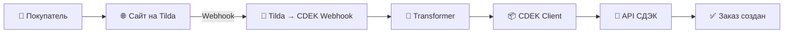

<div align="center">

# 🚚 Tilda → CDEK Webhook

### Автоматическая интеграция интернет-магазина **Tilda** с API **СДЭК**

Приём заказов • Преобразование данных • Создание отправлений • Отслеживание статусов


---

Микросервис для автоматической передачи заказов из **Tilda** в **СДЭК**.

</div>

---

# 📖 О проекте

Проект представляет собой отдельный REST-сервис, который принимает Webhook от платформы **Tilda**, преобразует полученные данные в формат API **СДЭК** и автоматически создаёт отправление.

Главная цель проекта — полностью исключить ручное оформление заказов в личном кабинете СДЭК.

После оформления заказа покупателем весь процесс происходит автоматически.

---

# ✨ Возможности

- 📦 Приём Webhook от Tilda
- 🚚 Создание отправлений в СДЭК
- 🏙 Поиск городов
- 📍 Поиск ПВЗ
- 📋 Получение информации о заказе
- 🔄 Получение статусов отправлений
- 📖 Swagger/OpenAPI
- 🧪 Unit-тесты
- 🔐 OAuth авторизация СДЭК

---

# ⚙ Как работает сервис



---

# 🏗 Архитектура проекта

```
app/

├── main.py
├── auth.py
├── cdek_client.py
├── transformer.py
├── catalog.py
├── config.py
├── logger.py
│
└── models/
    ├── order.py
    ├── tariff.py
    └── __init__.py

tests/

├── conftest.py
├── test_order_flow.py

docs/

├── minimal-order.json
```

---

# 🚀 Быстрый старт

## Клонирование

```bash
git clone https://github.com/WaskerOne1/tilda-cdek-webhook.git

cd sdek-api
```

## Создание виртуального окружения

```bash
python -m venv .venv
```

Windows

```powershell
.\.venv\Scripts\activate
```

Linux

```bash
source .venv/bin/activate
```

---

## Установка зависимостей

```bash
pip install -r requirements.txt
```

---

# 🔐 Настройка

Создайте файл `.env`

```env
CDEK_API=https://api.edu.cdek.ru

CLIENT_ID=

CLIENT_SECRET=

SENDER_LOCATION_CODE=

SENDER_LOCATION_ADDRESS=

SENDER_PHONE=
```

Для Production необходимо заменить

```
https://api.edu.cdek.ru
```

на

```
https://api.cdek.ru
```

и использовать боевые ключи.

---

# ▶ Запуск

```bash
uvicorn app.main:app --reload
```

или

```bash
python run.py
```

После запуска доступны

Swagger

```
http://127.0.0.1:8000/docs
```

OpenAPI

```
http://127.0.0.1:8000/openapi.json
```

---

# 🧪 Тестирование

Запуск тестов

```bash
pytest -q
```

Во время разработки были протестированы:

✅ Авторизация OAuth

✅ Поиск городов

✅ Получение списка ПВЗ

✅ Создание заказа

✅ Получение информации о заказе

✅ Проверка различных вариантов payload

---

# 📚 Используемые технологии

| Технология | Назначение |
|------------|------------|
| Python 3.12 | Основной язык |
| FastAPI | REST API |
| Requests | Работа с HTTP |
| Uvicorn | ASGI сервер |
| Pytest | Тестирование |
| Loguru | Логирование |

---

# 📑 Используемая документация

## СДЭК

🔹 Авторизация

https://apidoc.cdek.ru/#tag/Authorization

🔹 Создание заказа

https://apidoc.cdek.ru/#tag/Order

🔹 Города

https://apidoc.cdek.ru/#tag/Location

🔹 Пункты выдачи

https://apidoc.cdek.ru/#tag/Delivery-points

---

## Tilda

🔹 API

https://help-ru.tilda.cc/api

🔹 Forms API

https://help-ru.tilda.cc/forms

---

# 💡 Что было интересного при разработке

Во время разработки была обнаружена особенность API СДЭК.

При использовании

```
delivery_point
```

нельзя одновременно передавать

```
to_location.address
```

иначе API возвращает ошибку

```
v2_delivery_address_multivalued
```

После корректировки структуры запроса заказы начали успешно создаваться.

---

# 📌 Статус проекта

## Версия **v1.0**

Реализовано:

- ✅ Приём заказов из Tilda
- ✅ Преобразование данных
- ✅ Работа с API СДЭК
- ✅ Поиск городов
- ✅ Поиск ПВЗ
- ✅ Создание отправлений
- ✅ Получение статусов
- ✅ Unit-тесты
- ✅ Локальное тестирование

---

# 🔮 Дальнейшие планы

- [ ] Тестирование на тестовом сайте Tilda
- [ ] Подключение боевого сайта
- [ ] Развёртывание на Ubuntu Server
- [ ] Настройка HTTPS
- [ ] Docker
- [ ] GitHub Actions
- [ ] Автоматическое обновление каталога товаров
- [ ] Поддержка нескольких служб доставки

---

# 👨‍💻 Автор

Проект разработан в качестве практической работы по изучению REST API, FastAPI и автоматизации бизнес-процессов интернет-магазина на платформе **Tilda**.

Основная цель — полностью автоматизировать передачу заказов в службу доставки **СДЭК**.

---

<div align="center">

### ⭐ Если проект оказался полезным — поставьте звезду репозиторию.

Спасибо за внимание!

</div>